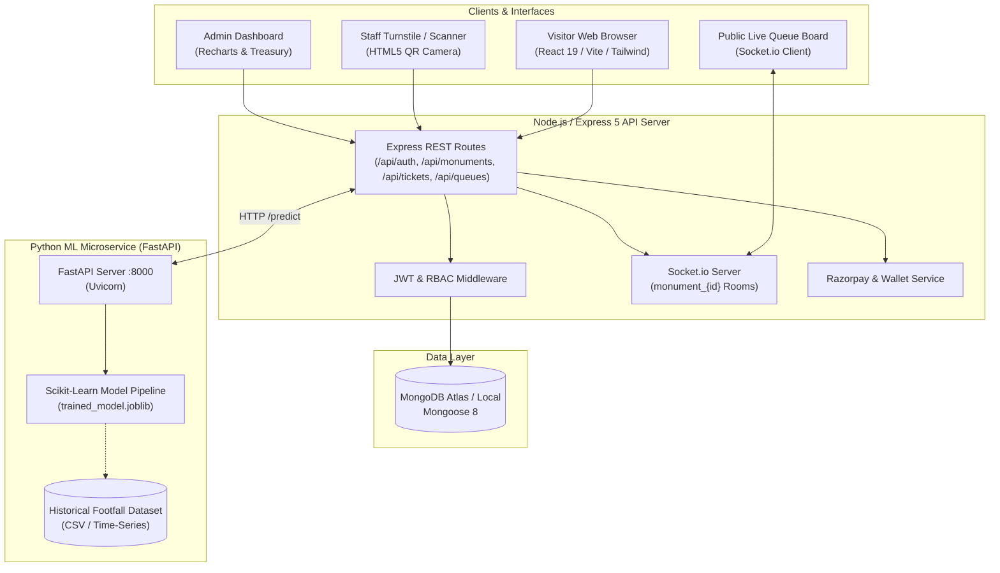

# 🏛️ Heritage Monument E-Ticketing & Visitor Queue Management System

[](https://nodejs.org/)
[](https://react.dev/)
[](https://vitejs.dev/)
[](https://fastapi.tiangolo.com/)
[](https://www.mongodb.com/)
[](https://tailwindcss.com/)
[](https://socket.io/)
[](https://opensource.org/licenses/ISC)

> An end-to-end smart ticketing, real-time virtual queue dispatch, and machine learning-powered visitor footfall forecasting platform designed for national heritage sites, cultural monuments, and archaeological destinations.

---

## 📌 Table of Contents

- [Overview](#-overview)
- [Key Features](#-key-features)
  - [Visitor Experience](#1-visitor-experience)
  - [Monument Staff Operations](#2-monument-staff-operations)
  - [Administrative Command Center](#3-administrative-command-center)
  - [Machine Learning Footfall Forecasting](#4-machine-learning-footfall-forecasting)
- [System Architecture](#-system-architecture)
- [Project Structure](#-project-structure)
- [Machine Learning Performance & Benchmarks](#-machine-learning-performance--benchmarks)
- [Tech Stack](#-tech-stack)
- [Getting Started](#-getting-started)
  - [Prerequisites](#prerequisites)
  - [1. Backend Setup](#1-backend-setup)
  - [2. Frontend Setup](#2-frontend-setup)
  - [3. Machine Learning Microservice Setup](#3-machine-learning-microservice-setup)
- [Configuration & Environment Variables](#-configuration--environment-variables)
  - [Backend (`backend/.env`)](#backend-backendenv)
  - [Frontend (`frontend/.env`)](#frontend-frontendenv)
- [API Reference & Route Matrix](#-api-reference--route-matrix)
- [Running Automated Tests](#-running-automated-tests)
- [Deployment Guide](#-deployment-guide)
- [Project Team](#-project-team)
- [License](#-license)

---

## 📖 Overview

Heritage sites such as the **Taj Mahal**, **Red Fort**, **Qutub Minar**, and **Meenakshi Amman Temple** experience unpredictable visitor influx, prolonged physical queues, ticket scalping, and localized bottlenecks.

The **Heritage Monument E-Ticketing and Visitor Queue Management System** addresses these issues through:
1. **Controlled Time-Slot Capacity**: Capping visitors per time-window to prevent overcrowding and preserve architectural integrity.
2. **Dynamic Digital QR Passports**: Anti-counterfeit QR passes encoded with visit windows, strict stay limits (e.g., 3-hour ASI turnstile rules), and automated validation.
3. **Real-Time Virtual Queuing**: Socket-driven queue synchronization allowing visitors to wait comfortably while tracking live queue status from public display boards or smartphones.
4. **Predictive Footfall Intelligence**: An ML forecasting pipeline comparing historical trends, holidays, weekdays, and seasonal factors to alert administrators of footfall surges in advance.
5. **Integrated Payment & Treasury**: Native digital wallet transactions with Razorpay integration and administrative balance audit controls.

---

## ✨ Key Features

### 1. Visitor Experience
- **Interactive Monument Directory**: Search, filter by state, historical era, ticket pricing, and operating hours.
- **Time-Slot Booking & Multi-Ticket Checkout**: Book individual or bulk visits across forenoon/afternoon sessions with real-time remaining capacity indicators.
- **Dual Pricing Tiers**: Distinct domestic (INR) and international visitor pricing with SAARC/BIMSTEC concession guidelines.
- **Digital Pass & QR Generation**: High-resolution, verifiable dynamic QR codes with ticket status, token number, and slot timings.
- **Digital Wallet & Seamless Top-Up**: In-app wallet powered by Razorpay for fast checkout, ticket refunds, and balance logs.
- **Public Live Queue Screen**: Live web display (`/queue/:monumentId`) showing active token called, estimated wait time, and queue velocity.

### 2. Monument Staff Operations
- **Real-Time Queue Dispatcher (`/staff/queue`)**:
  - Live socket subscription to monument queue channels.
  - One-click actions: **Call Next**, **Mark Served**, or **Skip No-Shows**.
- **Hardware & Camera QR Scanner (`/staff/validate`)**:
  - Web camera barcode/QR scanner (`html5-qrcode`) and manual fallback.
  - Validates slot window validity, previous entry status, and 3-hour overstay limits.

### 3. Administrative Command Center
- **Executive Analytics Dashboard (`/admin`)**:
  - Live revenue counters, active tickets, completed visits, and peak slot usage.
- **Monument Catalog Management**:
  - Create and update monuments, configure daily and slot capacities, upload imagery, and toggle active status.
- **Role-Based Access Control (RBAC)**:
  - Role management across `visitor`, `staff`, and `admin` with granular permission gates.
- **Treasury & Wallet Audit Controls**:
  - Track ecosystem revenue, view transaction audit logs, and issue controlled manual wallet grants.
- **Surge Prediction & ML Insights**:
  - View multi-day predicted visitor counts vs. monument capacity thresholds.

### 4. Machine Learning Footfall Forecasting
- **HistGradientBoosting / Random Forest Regressors** trained on multi-year visitor volume, weather indicators, calendar events, and capacity profiles.
- Outperforms traditional moving-average baselines with a **>56% MAE reduction** and **>61% RMSE improvement**.
- High-throughput FastAPI microservice serving single and batch prediction endpoints (`/predict`).

---

## 🏛️ System Architecture



---

## 📁 Project Structure

```text
Heritage Monument Booking System/
├── backend/                         # Node.js + Express 5 API Server
│   ├── data_intake/                 # Government dataset import & audit scripts
│   ├── src/
│   │   ├── config/                  # Database (Mongoose) connection & configs
│   │   ├── controllers/             # Controller business logic (Auth, Monument, Tickets, etc.)
│   │   ├── middleware/              # JWT auth, role validation (RBAC), error handlers
│   │   ├── models/                  # Mongoose schemas (User, Monument, Ticket, QueueEntry, etc.)
│   │   ├── routes/                  # Modular Express router endpoints
│   │   ├── services/                # Specialized domain services (QR, Queue, Prediction, Wallet)
│   │   ├── app.js                   # Express application bootstrap & CORS setup
│   │   ├── seed.js                  # Initial database seeder
│   │   └── server.js                # Server entrypoint with Socket.io binding
│   ├── create_admin.js              # CLI utility to generate / promote admin accounts
│   ├── seed_dataset_monuments.js    # Comprehensive ASI monument data seeder
│   └── package.json                 # Backend dependencies & scripts
│
├── frontend/                        # React 19 + Vite + Tailwind CSS Single Page App
│   ├── public/                      # Static assets, monument photography, logos
│   ├── src/
│   │   ├── api/                     # Axios/Fetch API client wrappers
│   │   ├── components/              # Modular UI components (Navbar, Modal, QRScanner, Cards)
│   │   ├── context/                 # AuthContext, SocketContext, NotificationContext
│   │   ├── layouts/                 # Root layouts & protected role routes
│   │   ├── pages/                   # Application views (Home, Booking, Admin, Staff, Wallet, etc.)
│   │   ├── App.jsx                  # Main router configuration
│   │   └── main.jsx                 # React root mount
│   ├── tailwind.config.js           # Custom typography, colors, animations
│   ├── vite.config.js               # Vite build & proxy settings
│   └── package.json                 # Frontend dependencies & scripts
│
├── ml/                              # Python Machine Learning Microservice
│   ├── data/                        # Processed training and validation splits
│   ├── outputs/v1/                  # Serialized pipelines (.joblib), metrics, and charts
│   ├── src/
│   │   ├── config.py                # Hyperparameters, split dates, feature schema
│   │   ├── evaluate.py              # Metric computation (MAE, RMSE, MAPE)
│   │   ├── features.py              # Time-series feature engineering & pipeline builder
│   │   ├── models.py                # Regressor model declarations & baseline wrappers
│   │   ├── service.py               # FastAPI microservice for real-time inference
│   │   ├── train.py                 # End-to-end training pipeline
│   │   └── validation.py            # Data integrity validation rules
│   └── heritage_footfall_updated.csv# Multi-monument historical dataset
│
├── evaluate.py                      # Root CLI entrypoint to evaluate ML models
├── train.py                         # Root CLI entrypoint to train ML models
├── ml_experiment_config.json        # Experiment specifications and feature mappings
├── API_CONTRACT.md                  # Comprehensive REST API specifications
├── PROJECT_SPEC.md                  # Architectural guidelines and project scope
└── README.md                        # Master project documentation
```

---

## 📊 Machine Learning Performance & Benchmarks

The predictive footfall engine forecasts expected visitor load up to 30 days in advance. Evaluated on a chronological out-of-time test split across 1,914 individual observation windows:

| Metric | Baseline (Rolling Mean) | Proposed ML Pipeline | Improvement |
| :--- | :---: | :---: | :---: |
| **MAE** (Mean Absolute Error) | **1,908.25** | **821.95** | **+56.93%** |
| **RMSE** (Root Mean Squared Error) | **4,891.27** | **1,884.25** | **+61.48%** |
| **MAPE** (Mean Absolute % Error) | **25.88%** | **11.53%** | **+55.45%** |

*Artifacts generated in `ml/outputs/v1/`:*
- `predictions_vs_actual_chart.png`: Visual residual analysis over test date ranges.
- `baseline_vs_model_chart.png`: Comparative error metric benchmark chart.
- `trained_model.joblib`: Production model pipeline artifact.

---

## 🛠️ Tech Stack

| Domain | Technology / Library | Purpose |
| :--- | :--- | :--- |
| **Frontend Framework** | React 19 + Vite 6 | High-speed Single Page Application (SPA) |
| **Styling** | Tailwind CSS 3.4 | Responsive, custom component design |
| **State & Navigation** | React Router v7 | Client-side routing with role-based layout guards |
| **Real-Time WebSockets**| Socket.io-client 4.8 | Live queue status & instant token call updates |
| **Data Visualization** | Recharts 3.10 | Admin charts for footfall trends and revenue analytics |
| **QR Code Processing** | `qrcode.react` / `html5-qrcode` | Digital pass generation and camera-based turnstile scanning |
| **Backend Runtime** | Node.js + Express 5 | Scalable RESTful API and WebSocket orchestration |
| **Database & ODM** | MongoDB Atlas + Mongoose 8 | Document storage for users, monuments, tickets, queues |
| **Authentication** | JWT (`jsonwebtoken`) + `bcryptjs` | Secure session tokens with salt-hashed passwords |
| **OAuth & Payments** | Google Auth Library + Razorpay | Google One-Tap authentication & digital payment gateway |
| **Machine Learning** | Python 3.10+, Scikit-Learn, Pandas | HistGradientBoosting / Random Forest Regressors |
| **Model Serving** | FastAPI + Uvicorn | Sub-millisecond REST inference microservice |

---

## 🚀 Getting Started

### Prerequisites

Ensure you have the following installed on your workstation:
- **Node.js** (v18.0.0 or later) & **npm**
- **Python** (v3.10 or later) & **pip**
- **MongoDB** (local instance running on `localhost:27017` or a MongoDB Atlas URI)
- **Git**

---

### 1. Backend Setup

1. Open your terminal and navigate to the backend directory:
   ```bash
   cd backend
   ```

2. Install Node dependencies:
   ```bash
   npm install
   ```

3. Set up environment variables:
   Create a `.env` file in `backend/` by copying `.env.example`:
   ```bash
   cp .env.example .env
   ```
   *(Update `MONGO_URI`, `JWT_SECRET`, and payment keys as needed. Defaults connect to local MongoDB).*

4. Seed the database with heritage monuments:
   ```bash
   node seed_dataset_monuments.js
   ```

5. Create an initial Administrator account:
   ```bash
   npm run create:admin
   ```
   *(Default credentials created: `admin@heritage.com` / `adminpassword123`)*

6. Start the backend development server:
   ```bash
   npm run dev
   ```
   *The server starts on `http://localhost:5000` (or `PORT` specified in `.env`).*

---

### 2. Frontend Setup

1. In a new terminal window, navigate to the frontend directory:
   ```bash
   cd frontend
   ```

2. Install dependencies:
   ```bash
   npm install
   ```

3. Create the frontend environment configuration:
   ```bash
   cp .env.example .env
   ```
   *(Set `VITE_API_URL=http://localhost:5000/api` and `VITE_SOCKET_URL=http://localhost:5000`)*

4. Launch the Vite development server:
   ```bash
   npm run dev
   ```
   *Open `http://localhost:5173` in your browser.*

---

### 3. Machine Learning Microservice Setup

1. Navigate to the `ml` folder or run from root:
   ```bash
   cd ml
   ```

2. Install Python dependencies:
   ```bash
   pip install fastapi uvicorn pydantic pandas numpy scikit-learn joblib matplotlib
   ```

3. Train and serialize the model (optional if pre-trained artifacts in `outputs/v1` are present):
   ```bash
   python -m ml.src.train
   ```

4. Launch the FastAPI inference microservice:
   ```bash
   uvicorn ml.src.service:app --host 127.0.0.1 --port 8000 --reload
   ```
   *The ML service documentation is live at `http://127.0.0.1:8000/docs`.*

---

## ⚙️ Configuration & Environment Variables

### Backend (`backend/.env`)

| Variable | Description | Default / Example |
| :--- | :--- | :--- |
| `PORT` | Backend HTTP port | `5000` |
| `NODE_ENV` | Environment mode | `development` / `production` |
| `MONGO_URI` | MongoDB Connection String | `mongodb://localhost:27017/heritage_monument_booking` |
| `JWT_SECRET` | Secret key for signing user auth tokens | *Secure 64-character hex string* |
| `ORIGIN` | Allowed CORS origins (comma-separated) | `http://localhost:5173` |
| `ML_SERVICE_URL` | Endpoint for Python ML service | `http://127.0.0.1:8000` |
| `RAZORPAY_KEY_ID` | Razorpay Merchant Test Key | `rzp_test_...` |
| `RAZORPAY_KEY_SECRET` | Razorpay Merchant Secret Key | `...` |
| `GOOGLE_CLIENT_ID` | Google OAuth Web Client ID | `...apps.googleusercontent.com` |

### Frontend (`frontend/.env`)

| Variable | Description | Default / Example |
| :--- | :--- | :--- |
| `VITE_API_URL` | Base API route URL | `http://localhost:5000/api` |
| `VITE_SOCKET_URL` | Socket.io server origin | `http://localhost:5000` |
| `VITE_GOOGLE_CLIENT_ID` | Google OAuth Client ID for login | `...apps.googleusercontent.com` |
| `VITE_RAZORPAY_KEY_ID` | Public Razorpay Test Key | `rzp_test_...` |

---

## 📡 API Reference & Route Matrix

For full payload contracts and schema definitions, see [`API_CONTRACT.md`](./API_CONTRACT.md).

### Public & Authentication Routes
| Method | Endpoint | Description |
| :--- | :--- | :--- |
| `GET` | `/api/health` | Service health check |
| `POST` | `/api/auth/register` | Register a new visitor account |
| `POST` | `/api/auth/login` | Authenticate user and receive JWT |
| `POST` | `/api/auth/google-login` | Authenticate using Google OAuth token |
| `GET` | `/api/monuments` | List all active monuments with search/filters |
| `GET` | `/api/monuments/:id` | Get details, slot capacity, and pricing for a monument |

### Ticketing & Virtual Queue
| Method | Endpoint | Access | Description |
| :--- | :--- | :--- | :--- |
| `POST` | `/api/tickets/book` | User | Book slot ticket (supports multi-ticket/bulk) |
| `GET` | `/api/tickets/my-tickets` | User | Retrieve booked digital passes and QR data |
| `PATCH` | `/api/tickets/:id/cancel`| User | Cancel ticket and issue wallet refund |
| `GET` | `/api/queues/:monumentId` | Public | Live queue state, current token, and wait time |
| `POST` | `/api/queues/join` | User | Enqueue validated ticket into virtual line |

### Staff Operations
| Method | Endpoint | Access | Description |
| :--- | :--- | :--- | :--- |
| `GET` | `/api/staff/queues/:monumentId` | Staff / Admin | Live staff queue controller board |
| `POST` | `/api/staff/queues/call-next` | Staff / Admin | Dispatch next visitor token in line |
| `POST` | `/api/staff/queues/complete` | Staff / Admin | Mark visitor as completed / served |
| `POST` | `/api/staff/queues/skip` | Staff / Admin | Mark ticket as skipped / no-show |
| `POST` | `/api/staff/tickets/validate` | Staff / Admin | Scan and validate QR code entry pass |

### Admin Operations & ML Intelligence
| Method | Endpoint | Access | Description |
| :--- | :--- | :--- | :--- |
| `GET` | `/api/admin/dashboard/summary` | Admin | Aggregate KPI metrics and statistics |
| `POST` | `/api/admin/monuments` | Admin | Create or modify monument profile |
| `GET` | `/api/admin/users` | Admin | List all registered users and assign roles |
| `GET` | `/api/admin/predictions/:id` | Admin | Fetch ML visitor predictions and surge alert |
| `GET` | `/api/admin/treasury/summary` | Admin | Treasury revenue analytics & audit log |
| `POST` | `/api/admin/treasury/grant` | Admin | Issue audited wallet balance grant |

---

## 🧪 Running Automated Tests

### Backend Unit & Integration Tests (Jest & Supertest)
```bash
cd backend
npm test
```
*Executes comprehensive test suites including:*
- `monuments.test.js`: Monument CRUD & slot capacity logic.
- `tickets.test.js`: Ticket issuance, QR encoding, and overstay calculation.
- `queue.test.js`: Real-time queue progression, calling, and skipping.
- `adminRbac.test.js`: Role-based route authorization guards.
- `payments.test.js` & `wallet.test.js`: Wallet transactions, balance audits, and refund handling.

### Frontend Component Tests (Vitest)
```bash
cd frontend
npm test
```

### ML Pipeline & Validation Tests (Pytest)
```bash
cd ml
pytest tests/
```

---

## 🌐 Deployment Guide

### Frontend Deployment (Vercel)
The frontend contains a configured `vercel.json` for client-side routing rewrites.
1. Connect your repository to [Vercel](https://vercel.com).
2. Set the root directory to `frontend`.
3. Add environment variables:
   - `VITE_API_URL`: Your deployed backend API URL (e.g., `https://backend.onrender.com/api`).
   - `VITE_SOCKET_URL`: Your deployed backend URL without `/api`.
   - `VITE_GOOGLE_CLIENT_ID` & `VITE_RAZORPAY_KEY_ID`.
4. Deploy!

### Backend Deployment (Render / Railway / VPS)
1. Set root directory to `backend`.
2. Build command: `npm install`.
3. Start command: `npm start`.
4. Configure environment variables (`MONGO_URI`, `JWT_SECRET`, `ORIGIN`, `ML_SERVICE_URL`).

### ML Service Deployment (Docker / FastAPI Cloud)
Can be containerized with Python 3.10 and run via:
```bash
uvicorn ml.src.service:app --host 0.0.0.0 --port 8000
```

---

## 👥 Project Team

Developed with ❤️ for Heritage Monument Preservation and Smart Tourism:

- **Balasutharsan M**
- **Thejeswar V G**
- **Beniel Raja V**

---

## 📄 License

This project is licensed under the [ISC License](https://opensource.org/licenses/ISC).
